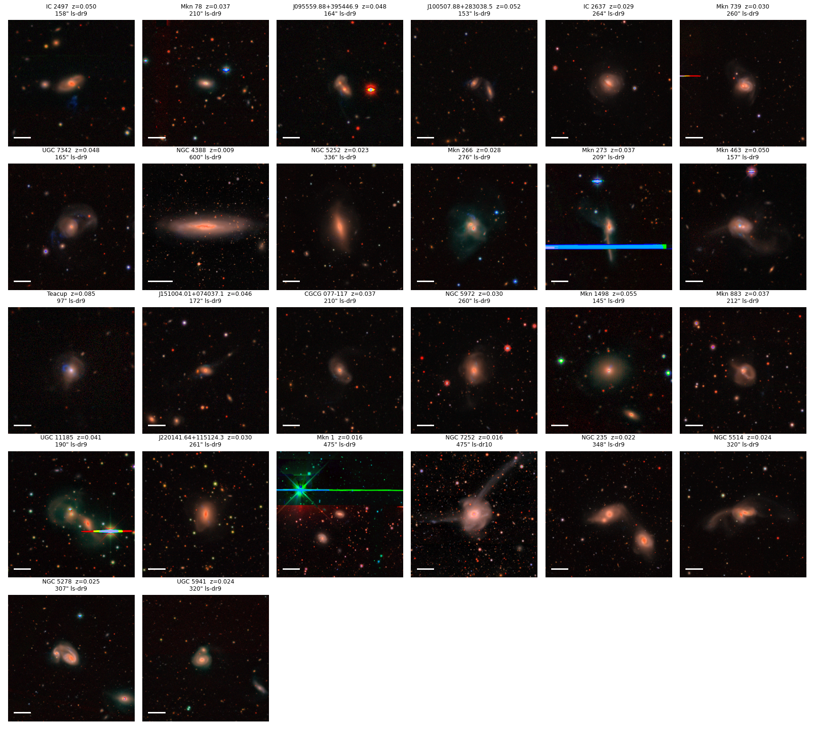

# hanny_images

Legacy Survey (DECaLS/DR9, DR10 fallback) g,r,z cutouts and RGB images of the
spectroscopically confirmed analogues of Hanny's Voorwerp (AGN-ionized extended
emission-line regions, EELRs, >~10 kpc from the nucleus).



## Sample (26 systems, `data/voorwerp_analogues.csv`)

| Source | Systems |
|---|---|
| Keel et al. 2012, MNRAS 420, 878 — [arXiv:1110.6921](https://arxiv.org/abs/1110.6921) | 19 "Confirmed AGN-ionized" (long-slit table) |
| Keel et al. 2017, ApJ 835, 256 — [arXiv:1612.06006](https://arxiv.org/abs/1612.06006) | IC 2497 (Hanny's Voorwerp) |
| Keel et al. 2024, MNRAS 530, 1624 (TELPERION) — [arXiv:2403.04898](https://arxiv.org/abs/2403.04898) | Mkn 1, NGC 7252, NGC 235, NGC 5514, NGC 5278/9, UGC 5941 (Mkn 266 is in Keel 2012) |

Columns: `name, sdss_name, ra, dec` (deg, ICRS), `z, nucleus, source`, and for
TELPERION `eelr_rproj_kpc` (projected cloud distance) and `fading` (energy-budget verdict, Keel 2024 Table 5).
Keel 2012/2017 positions come from SDSS designations; TELPERION positions from NED.

## Cutouts

Field = 160 kpc box (Planck18), clipped to 60–600 arcsec, ≤800 pixels (pixel scale
coarsened as needed). RGB = Lupton asinh, z→R, r→G, g→B, scaled by the r-band sky MAD;
[O III]λ5007 falls in g at these redshifts, so EELRs appear blue/green.

## Run

Requires the sibling `../decals_cutout` repository (`fetch_decals_cube.fetch_cutout_set`)
and numpy, pandas, matplotlib, astropy, pytest.

```bash
python -m pytest -q scripts/test_pipeline.py
python scripts/build_catalog.py      # downloads arXiv sources to data/raw/ if missing
python scripts/make_cutouts.py       # FITS -> data/cutouts_fits/, PNG -> data/cutouts_rgb/
python scripts/plot_montage.py       # -> data/montage_rgb.png
```
